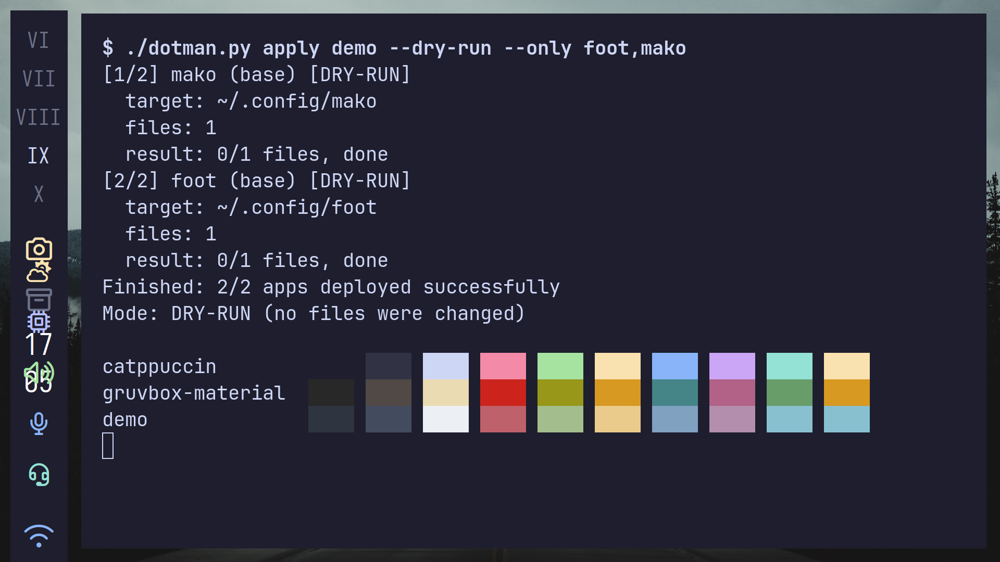

# dotman

**No longer maintained.** I stopped using dotman on 19 November 2026. My configs now live in a plain git repo that is not public. The last local changes are on the `last-local-2026-11-27` branch.

One theme file sets the colours and fonts of a whole Arch Linux desktop.



dotman renders each app's config from a Jinja2 template, backs up the old config, writes the new one and reloads the app. It covers Hyprland, Waybar, foot, Ghostty, mako, fish, bash, Starship, fastfetch, btop, cava, lazygit, bat, yazi, LazyVim, opencode, GTK 3 and 4, fonts and wallpapers.

## Run it

On Arch Linux:

```bash
sudo pacman -S --needed git python python-yaml python-jinja
git clone https://github.com/VarunAgarwalOfficial/dotman
cd dotman
./dotman.py list                        # the themes
./dotman.py apply demo --dry-run        # see what would change
./dotman.py apply demo --only foot      # theme one app
./dotman.py apply demo                  # theme everything
```

Old configs are saved in `~/.local/state/dotman/backups/` first.

To make a theme, copy `themes/demo.yaml`, change the colours, and apply it. Fonts and spacing are in `config.yaml`. The icon font there is Font Awesome 7 Pro; set `font_icons` to a font you have.

How templates, filters and variants work: [docs/guide.md](docs/guide.md). Adding an app: [CONTRIBUTING.md](CONTRIBUTING.md).

## Test

```bash
make check
```

It renders every template with every theme and writes nothing.

## Layout

```
dotman.py      entry point: list, apply, validate
src/           config loading, template rendering, backup and deploy
templates/     one folder of Jinja2 templates per app
themes/        the theme files (demo, catppuccin, gruvbox-material)
config.yaml    fonts, spacing and other settings shared by every theme
apps.yaml      where each app's config goes and how it is reloaded
tests/         renders every template with every theme
docs/          guide.md and the screenshot
archive/       old launcher scripts and a terminal rain demo, not used by dotman
```

## Status

Working, as of 26 November 2026. See [STATUS.md](STATUS.md).

## Licence

MIT (see [LICENSE](LICENSE)), except the opencode plugins in `templates/opencode`, which come from [opencode-worktree](https://github.com/kdcokenny/opencode-worktree) (MIT). Fonts and icons are not included; install your own.
